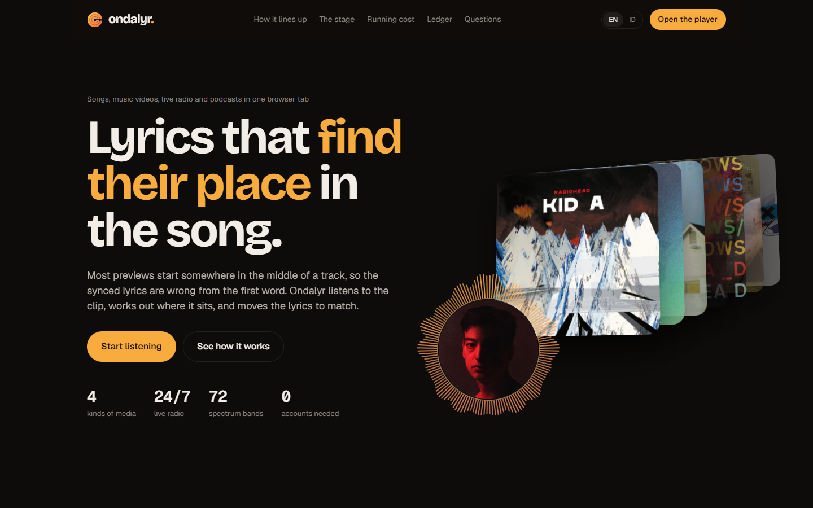
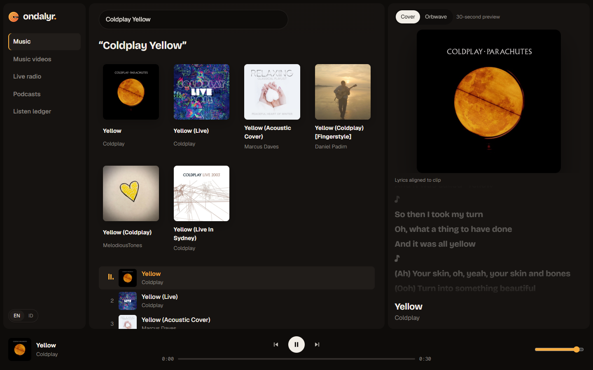
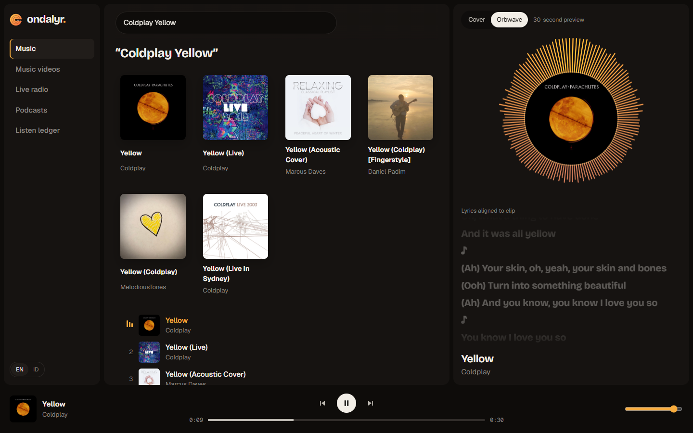
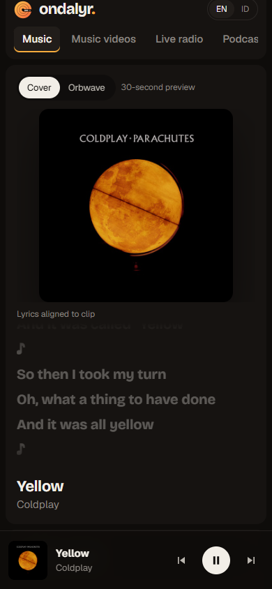
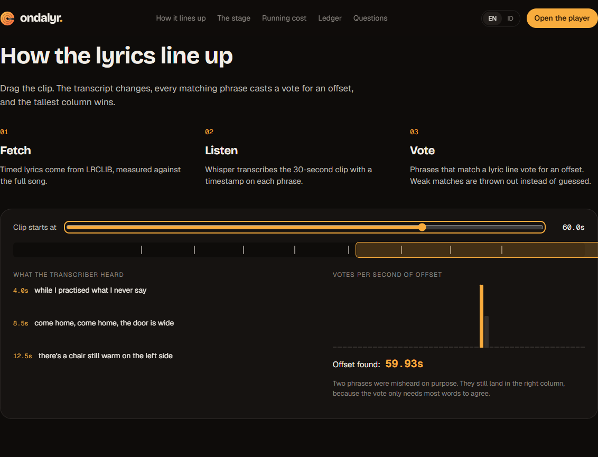
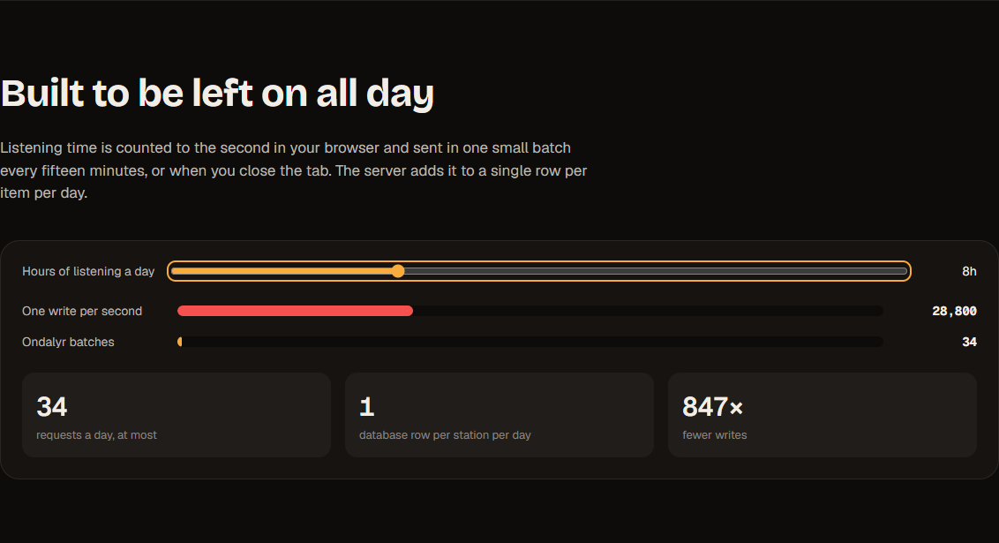
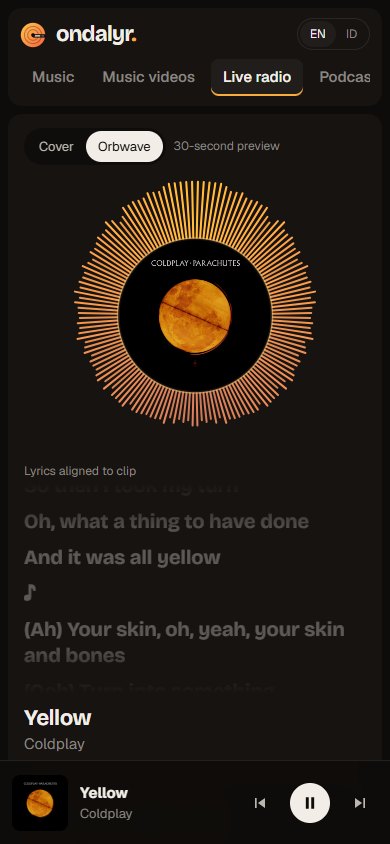

# Ondalyr

A light browser player for songs, music videos, live radio and podcasts. When a 30-second preview starts in the middle of a song, Ondalyr transcribes the clip, finds where it sits in the full track, and shifts the synced lyrics to match.

Live: https://ondalyr.vercel.app · Player: https://ondalyr.vercel.app/listen



| Player with re-timed lyrics | Orbwave stage | Phone, 390 px |
| --- | --- | --- |
|  |  |  |

## What it does

| Area | How |
| --- | --- |
| Full tracks | Whole songs from Audius (independent artists, free, no key). Its streams send `Access-Control-Allow-Origin: *`, so Orbwave reads the real audio and LRCLIB timings apply as they are |
| Spotify Premium | Optional. With `NEXT_PUBLIC_SPOTIFY_CLIENT_ID` set, the Full tracks tab offers a Spotify login (PKCE, no secret). The Web Playback SDK makes the tab a Spotify Connect device, so mainstream songs play whole and ad-free on the listener's own Premium account. Spotify streams the audio; Ondalyr only sends play, pause and seek, and LRCLIB timings apply as they are |
| Song previews | iTunes Search previews, relayed same-origin through `/api/media` so the Web Audio analyser can read them |
| Music videos | iTunes music-video previews, played on the stage with lyrics alongside |
| Live radio | Radio Browser directory, HTTPS and non-HLS streams only, with a log of what each station airs (below) |
| Podcasts | iTunes podcast search, then the RSS feed parsed by `/api/rss` |
| Lyrics | LRCLIB synced lyrics, re-timed by `/api/align` (Whisper on Groq, offset voting) |
| Stage | Cover, video, or Orbwave (72 mirrored spectrum bands) |
| Receipts | Solana devnet Memo transaction with the item id and seconds heard |
| Languages | English (default) and Indonesian |

## Listening data and running cost

Seconds are counted in the browser and kept in `localStorage`, so the count is exact even when the network drops. The browser sends one batch to `/api/tally` every 15 minutes, on track change, and when the tab is hidden or closed (`sendBeacon`). The server folds each batch into a single row per device, item and day with one `INSERT ... ON CONFLICT` statement.

For one listener with the radio on 24 hours a day, that comes to at most about 98 requests and one row a day. Writing once per second would be 86,400 requests. `GET /api/tally` (the weekly chart) is cached at the CDN for five minutes, so page views do not reach the database.

No Blob store is used. Listening data is a few integers per row, and Postgres handles that fine. A Blob store would only make sense for user uploads or exports, and the app has neither.

## Radio log

`scripts/recorder.mts` keeps a log of what up to 100 stations air, around the clock. It runs in GitHub Actions ([recorder.yml](.github/workflows/recorder.yml)): each job lasts about 5 h 40 min, and the next one is already queued in the same concurrency group, so the handover gap is about a minute.

- **Which stations:** any station someone plays in Ondalyr comes first, then the most-clicked HTTPS stations under pop, hits, top 40, dance, rock, kpop and indonesia tags. Streams listed twice under different ids are skipped. A station that sends no title ten times in a row is dropped.
- **How:** every 45 seconds it opens each stream, reads the first ICY metadata block (`StreamTitle`, usually after 16 KB of audio), and closes it. Almost every song runs longer than 45 seconds, so a song is still caught, and the job downloads about a sixtieth of what holding 100 streams open would.
- **What counts as a song:** `cleanTitle` in `src/lib/aired.ts` drops station names and slogans, ads, URLs, numeric catalogue ids and anything without both an artist and a title. Every rule comes from a title seen in the first test run.
- **What is stored:** each distinct song once in `song` (with play and station counts), and each airing as one `(station, song, at)` row in `aired`. Airings older than 30 days are deleted; songs are kept.
- **Hits first:** a song is a hit when one of its artist names exactly equals an artist on Deezer's overall or 21 genre charts (about 1,100 names, refreshed daily). Hits are always stored. Other songs are stored only while the database is under 350 MB (`BUDGET_BYTES`), so the free 512 MB tier never fills up.
- Only titles are stored. No audio is recorded.

A 6-minute test run against 100 stations wrote 127 airings of 115 songs, 14 of them hits, at about 50 bytes per airing.

## Setup

To turn on Spotify: create an app at developer.spotify.com/dashboard, tick Web API and Web Playback SDK, add the redirect URI `https://ondalyr.vercel.app/listen` (and `http://127.0.0.1:3000/listen` for local work), add each listener's Spotify email under User Management, and set `NEXT_PUBLIC_SPOTIFY_CLIENT_ID`. The Client ID is public; no secret is used.

```bash
npm install
cp .env.example .env.local   # fill in GROQ_API_KEY and DATABASE_URL
node --env-file=.env.local scripts/migrate.mjs
npm run dev
```

Both variables are optional. Without `GROQ_API_KEY`, lyrics show without re-timing. Without `DATABASE_URL`, tallies are accepted and dropped.

## Checks

`scripts/smoke.mjs` drives Chrome against a running build at 1440×900 and 390×844 and saves the screenshots in `docs/shots`. The desktop pass is also recorded to `docs/video`.

```bash
node scripts/smoke.mjs https://ondalyr.vercel.app
```

It checks that each page has no element past the right edge, that the alignment and cost demos react to their sliders, that the language switch works, that a searched song (Coldplay, "Yellow") plays and shows lyric lines, that Orbwave draws and radio stations load, that `/api/tally` accepts a batch, and that no page throws an uncaught error. The last run against the live site passed 23 of 23 checks; full output is in [docs/smoke-result.txt](docs/smoke-result.txt). The desktop recording of that run is [docs/video/smoke-desktop.webm](docs/video/smoke-desktop.webm). It is an unnarrated test run, not a walkthrough.

Earlier runs caught two layout bugs that are now fixed: on phones the player grid was 522 px wide inside a 390 px screen, and in Cover mode the album art grew past its row and sat under the lyrics.

| Alignment demo | Cost demo | Radio on a phone |
| --- | --- | --- |
|  |  |  |

## Known limits

- Without Spotify Premium, full tracks come only from Audius, which is mostly independent artists, and mainstream songs and music videos are 30-second iTunes previews.
- Spotify in Development Mode (February 2026 rules): the app owner must have Premium, at most five listeners can be added under User Management, and search returns 10 results per request (the tab asks for two pages). Spotify audio is DRM-protected, so Orbwave shows simulated motion for it. The login and playback path has not been tested end to end yet, because no Client ID is configured.
- The radio log trusts what stations announce. A station that sends wrong or no metadata is logged wrong or not at all.
- Lyrics come from LRCLIB. Many tracks in the iTunes trending list, especially low-profile uploads, have no entry there, and the player says so instead of showing a guess.
- Re-timing needs `GROQ_API_KEY`. Without it, synced lyrics run from the start of the full track and drift from the clip.
- The search box is shared across tabs, so a song search carries over to radio and podcasts.
- Devnet receipts need Phantom or Solflare. They are not covered by the smoke script and have not yet been tested end to end against the live site.
- The `anchor/` program is not deployed.

## Layout

```
src/app/            pages (landing, /listen) and API routes (media, rss, align, tally)
src/components/     player context, stage, lyrics, bar, views, landing demos, logo
src/lib/            sources, lyrics, i18n, solana, tally
scripts/migrate.mjs creates the listen_day table
anchor/             listen-ledger Anchor program (per-minute payments, crates); not deployed yet
```
